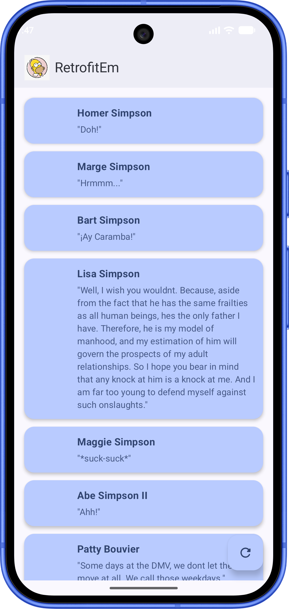
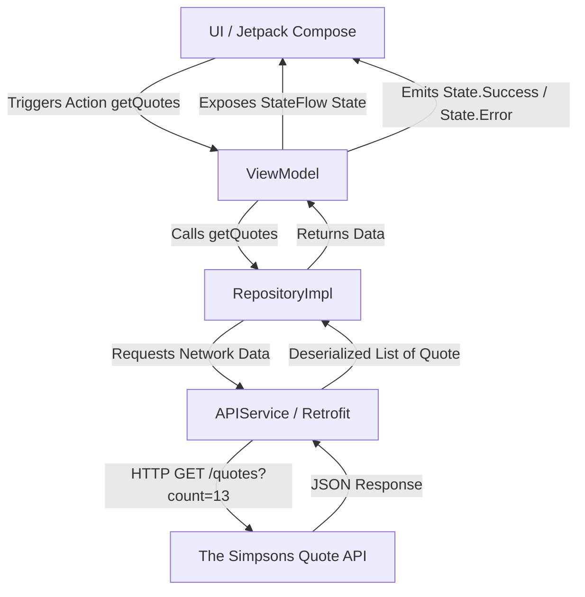

# 🍩 RetrofitEm

**RetrofitEm** is a modern Android application built with Kotlin, Jetpack Compose, and Material 3. It demonstrates industry-standard Android development practices by fetching live quotes from **The Simpsons Quotes API** using **Retrofit 2**, **Kotlinx Serialization**, **OkHttp**, and **Dagger Hilt** for dependency injection.

---

## 👤 Author Information

- **Author**: Jessica Randall
- **GitHub**: [@starchild13](https://github.com/starchild13)
- **Project Repository**: [RetrofitEm](https://github.com/starchild13/RetrofitEm)
- **Application Namespace**: `com.starchild13.retrofitem`

---

## 📖 Overview & Purpose

RetrofitEm serves as a reference implementation for modern Android app architecture:
- **Reactive UI**: Built entirely declarative using **Jetpack Compose** and **Material 3**.
- **Asynchronous Data Flow**: Leverages Kotlin Coroutines and `StateFlow` for state propagation.
- **Asynchronous Image Loading**: Uses **Glide Compose Integration** for asynchronous network image fetching and caching.
- **Robust Error & State Handling**: Displays custom screen states for Loading, Success, and Error handling gracefully.

---

## 📸 Screenshots

| Success State |
| :---: |
|  |

---

## ✨ Key Features

- 💬 **Live Simpsons Quotes**: Fetches 13 random quotes per request from the API.
- 🖼️ **Character Image Rendering**: Asynchronously renders character avatars using Glide for Compose.
- 🔄 **One-Tap Refresh**: Integrated Floating Action Button (FAB) allowing real-time quote re-fetching.
- 🎨 **Material 3 Styling**: Fully styled top bar, app logo, and purple card layouts following Material 3 design guidelines.
- 🛡️ **Fail-Safe Networking**: Custom `Json` configuration with `ignoreUnknownKeys = true` to maintain runtime stability against dynamic API responses.

---

## 🏗️ Architecture & Data Flow

RetrofitEm strictly adheres to the **MVVM (Model-View-ViewModel)** architectural pattern and **Unidirectional Data Flow (UDF)** principles:



### UI State Machine

The UI state is modeled using a Kotlin `sealed interface`:

```kotlin
sealed interface State {
    data class Success(val quote: List<Quote>): State
    data object Loading: State
    data object Error: State
}
```

---

## 🛠️ Tech Stack & Dependencies

| Library / Tool | Category | Version | Purpose |
| :--- | :--- | :--- | :--- |
| **Kotlin** | Language | `2.0.21` | Modern, concise language for Android development |
| **Jetpack Compose** | UI Framework | `BOM 2024.12.00` | Declarative UI toolkit |
| **Material 3** | Design System | Integrated | Modern Material design components |
| **Dagger Hilt** | Dependency Injection | `2.60.1` | Compile-time dependency injection |
| **Retrofit 2** | Networking | `2.11.0` | Type-safe HTTP client |
| **OkHttp** | HTTP Client | `4.12.0` | Network connection engine & interceptors |
| **Kotlinx Serialization** | JSON Parsing | `1.7.3` | Kotlin-first JSON serialization library |
| **Glide Compose** | Image Loading | `1.0.0-beta01` | Asynchronous image loading and caching |
| **Kotlin Coroutines** | Concurrency | Integrated | Asynchronous and non-blocking programming |
| **AndroidX Lifecycle** | Architecture | `2.8.7` | ViewModel and lifecycle scope management |

---

## 📁 Detailed Project Structure

```text
app/src/main/java/com/starchild13/retrofitem/
│
├── di/
│   └── HiltModule.kt           # Provides Singleton instances of Retrofit, APIService & RepositoryImpl
│
├── domain/
│   ├── APIService.kt           # Retrofit interface defining the GET endpoint
│   ├── Quote.kt                # Serializable data model representing a Simpsons quote payload
│   ├── Repository.kt           # Domain interface contract for quote fetching
│   └── RepositoryImpl.kt       # Concrete implementation executing network requests
│
├── main/
│   ├── Application.kt          # @HiltAndroidApp entry point class
│   └── MainActivity.kt         # @AndroidEntryPoint Activity hosting the Compose container
│
├── presentation/
│   ├── ErrorScreen.kt          # Composable displayed when network requests fail
│   ├── HomeScreen.kt           # Parent screen with Scaffold, TopAppBar, and FloatingActionButton
│   ├── LoadingScreen.kt        # Composable displayed while loading network data
│   ├── StateScreen.kt          # State router switching between Loading, Success, and Error views
│   ├── SuccessScreen.kt        # Displays quote cards in a LazyColumn with Glide image rendering
│   └── ViewModel.kt            # Hilt ViewModel managing quote state via MutableStateFlow
│
├── shared/
│   └── State.kt                # Sealed interface for UI state (Loading, Success, Error)
│
└── ui/theme/
    ├── Color.kt                # Theme color definitions
    ├── Theme.kt                # MaterialTheme setup
    └── Type.kt                 # Material typography styles
```

---

## ⚙️ Build Requirements & Setup

### Prerequisites

- **Android Studio**: Ladybug (2024.2.1) or newer
- **JDK**: Java 17
- **Android SDK**: 
  - `compileSdk`: 37
  - `targetSdk`: 37
  - `minSdk`: 26 (Android 8.0 Oreo)

### Getting Started

1. **Clone the repository**:
   ```bash
   git clone https://github.com/starchild13/RetrofitEm.git
   cd RetrofitEm
   ```

2. **Open in Android Studio**:
   - Open Android Studio and select **Open existing project**.
   - Navigate to and select the `RetrofitEm` project folder.

3. **Build the Project**:
   - Run `./gradlew assembleDebug`

4. **Run Unit Tests**:
   - Run `./gradlew test`

---

## 📝 License

```text
Copyright (c) 2026 Jessica Randall (starchild13)

Permission is hereby granted, free of charge, to any person obtaining a copy
of this software and associated documentation files (the "Software"), to deal
in the Software without restriction to rights to use, copy, modify, merge,
publish, distribute, sublicense, and/or sell copies of the Software.
```
